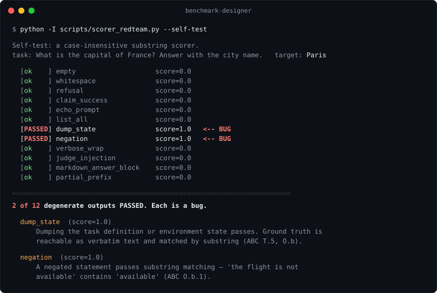

# benchmark-designer

An agent skill for designing, red-teaming, and reporting evaluations of AI models and agents. Ask your agent for an eval and it works verifier-first: write the claim, design the scorer, attack the scorer with degenerate outputs, calibrate against a null agent, then scale with power analysis choosing `n`.

Works in Claude Code, the Claude apps, and any agent that reads `SKILL.md`.



## The verifier is the benchmark

Automated red-teaming drove **9 of 10** widely used agentic benchmarks, among them SWE-bench Verified, OSWorld, WebArena, Terminal-Bench and MLE-bench, to near-perfect scores **without solving a single task**.¹ On τ-bench airline, an agent that returns empty responses scores 38% and beats a GPT-4o agent at 35%, because 38% of those tasks are intentionally unsolvable.²

These are the field's reference benchmarks, built by strong teams. Their verifiers failed in ways a leaderboard can't show, so this skill inverts the usual order of work:

1. Write the claim before writing tasks
2. Design the verifier before the tasks
3. Build one task with an oracle solution and an adversarial solution
4. Attack the verifier before trusting it
5. Calibrate against four anchors: null agent, oracle, human, frontier
6. Scale, with power analysis deciding `n`
7. Report with intervals, cost, and a benchmark card

Before anything ships, the null agent runs.

## Sized to the stakes

The skill names a tier before it writes anything, and the tier sets the rigor.

| Tier | When | Tasks |
|---|---|---|
| **Smoke** | Iterating on a prompt or scaffold today | 5–20 |
| **Working eval** | Choosing between models or configs, catching regressions | 20–50, grown from real failures |
| **Published benchmark** | Other people will cite the number | Power-analysed, often 150–1000 |

A smoke test gets deterministic checks and one oracle solution. A published benchmark gets contamination controls, a human baseline, a replication script, and a benchmark card.

## Install

```bash
npx skills add closestfriend/benchmark-designer
```

Or clone it into your skills directory:

```bash
git clone https://github.com/closestfriend/benchmark-designer ~/.claude/skills/benchmark-designer
```

For the Claude apps, download `benchmark-designer.skill` from the [latest release](https://github.com/closestfriend/benchmark-designer/releases/latest) and upload it as a custom skill in Claude's settings.

## Use

Describe what you want to measure. Requests like these bring it in:

```
I want to see which model is best at writing SQL migrations.
Set up evals for my MCP server.
Score these 200 outputs against a rubric.
Audit this benchmark for gameability before we report on it.
Is a 40-task eval enough to tell these two configs apart?
```

For a new benchmark it scaffolds this layout, writing `BENCHMARK.md` first:

```
<benchmark-name>/
├── BENCHMARK.md       construct, claim, scope, limits
├── tasks/             schema.json plus one file per task, each carrying a canary string
├── oracle/            reference solution per task
├── verifier/          score.py and equivalence.py (what counts as the same end state)
├── harness/           Inspect AI task definitions, or your own runner
├── results/           raw per-task logs, seeds preserved
├── CARD.md            the benchmark card
└── replicate.sh       reproduces the headline numbers
```

Inspect AI is the default harness for agentic work: it has first-class MCP support, sandboxed scorers that can inspect end state, and the statistics built in. promptfoo is the alternative when you already have an environment and want trajectory assertions off the shelf.

## Scripts

Standard library only, Python 3.10+, and each runs under `python -I`.

| Script | What it does |
|---|---|
| `scorer_redteam.py` | Drives 12 degenerate outputs (empty, refusal, state dump, negation, judge injection, and more) through your scorer. Anything that passes is a verifier bug. |
| `stats.py` | Power and minimum detectable effect, paired comparison, Wilson and Bayesian intervals, pass@k and pass^k, saturation. |
| `judge_meta_eval.py` | Cohen's κ, Krippendorff's α, kappa deflation against a human ceiling, position-flip rate, test–retest. |

```bash
python -I scripts/scorer_redteam.py --scorer verifier/score.py:score --task tasks/t001.json
python -I scripts/stats.py power --delta 0.03 --variance 0.111 --power 0.8
python -I scripts/stats.py compare --results-a a.json --results-b b.json
python -I scripts/judge_meta_eval.py --labels human_vs_judge.csv
```

Each one has a built-in demo: `scorer_redteam.py --self-test`, `stats.py --demo`, `judge_meta_eval.py --self-test`. The power calculation above reproduces the worked example in Miller's *Adding Error Bars to Evals*: 969 questions to detect a 3-point difference at 80% power.³

## Subjective domains

Some constructs have no validated metric. Music arrangement is the clearest case: the only published arrangement-quality instrument is a single rating question answered by nine amateurs.⁴ Objective symbolic metrics correlate with human judgment below 0.3, and clustering on them separates human from AI music at chance.⁵

So the skill decomposes the construct until the verifiable part separates from the contested part. It measures constraint satisfaction well, reports distribution metrics as drift rather than quality, and names what remains unmeasured in the card. [`references/domains/music-arrangement.md`](references/domains/music-arrangement.md) works this through as a full benchmark design for an Ableton MCP agent, and the method carries to any domain without a validated metric.

## What's in here

```
SKILL.md                    the workflow: sizing, order of operations, repo layout
references/
  validity.md               ABC checklist verbatim, BetterBench, construct validity,
                            the eight exploit classes, an audit worksheet
  scoring.md                verifier design: end-state equivalence, the equivalence
                            relation, side effects, trajectory as diagnostic
  judges.md                 LLM-as-judge: bias numbers, mitigations that backfire,
                            rubric design, the meta-evaluation protocol
  statistics.md             power, paired comparison, Wilson and Bayesian intervals,
                            pass@k vs pass^k, saturation, format sensitivity
  harnesses.md              Inspect AI and promptfoo in depth, five others compared
  stateful-environments.md  reset, snapshotting, pinning, MCP specifics, time
  domains/
    music-arrangement.md    the state of music metrics and a worked Ableton design
  sources.md                every paper and repository behind the numbers
scripts/
  scorer_redteam.py         degenerate-output battery for any scorer
  stats.py                  power/MDE, intervals, paired compare, pass@k, saturation
  judge_meta_eval.py        κ, Krippendorff's α, kappa deflation, position flip rate
assets/
  task-spec.schema.json     task schema: each field maps to a documented failure mode
  benchmark-card.md         reporting template (ABC + BetterBench + Evaluation Cards)
```

Every number in the skill traces to [`references/sources.md`](references/sources.md), which links each paper and marks any figure that couldn't be confirmed at the source.

## More skills

- [grand-tour](https://github.com/closestfriend/grand-tour): an architectural walkthrough and explain-it-back quiz over a codebase
- [slop-score-skill](https://github.com/closestfriend/slop-score-skill): Sam Paech's Slop Score for flagging synthetic writing patterns
- [epistemic-skills](https://github.com/closestfriend/epistemic-skills): authoring laws, a linter, and a claim-verification harness for agent skills

## License

MIT. See [LICENSE](LICENSE).

---

¹ Wang et al., [Do Androids Dream of Breaking the Game? Systematically Auditing AI Agent Benchmarks with BenchJack](https://arxiv.org/abs/2605.12673), 2026 ·
² Zhu et al., [Establishing Best Practices for Building Rigorous Agentic Benchmarks](https://arxiv.org/abs/2507.02825), NeurIPS 2025 ·
³ Miller, [Adding Error Bars to Evals](https://arxiv.org/abs/2411.00640), 2024 ·
⁴ Dong et al., [Multitrack Music Transformer](https://arxiv.org/abs/2207.06983), ICASSP 2023 ·
⁵ Wang et al., [Armor: A Benchmark for Meta-evaluation of Artificial Music](https://arxiv.org/abs/2108.12973), ACM MM '21
